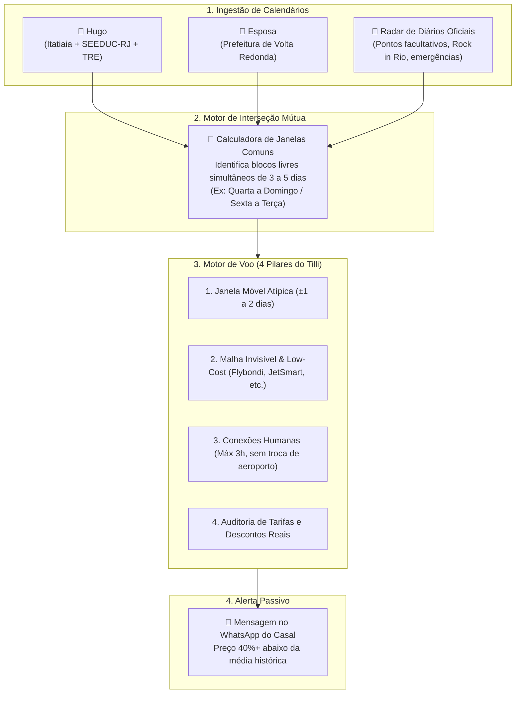

# ✈️ AeroFolga

> **O radar inteligente que cruza calendários de servidores públicos (folgas, feriados municipais, recessos e TRE) com passagens aéreas em tarifa promocional atípica.**  
> *Vespasiano Labs — Projeto S-08*

---

## 🏛️ 1. O Manifesto do Produto

No Brasil, milhões de servidores públicos, professores e casais assalariados vivem o mesmo dilema: **querem viajar, mas as passagens aéreas são proibitivas nos fins de semana convencionais**, enquanto centenas de dias de folga no meio da semana são desperdiçados em casa por pura falta de sincronização.

O **AeroFolga** nasceu para resolver a assimetria do *"Quebra-Cabeça do Casal Servidor Público"*:
* **Hugo:** Professor da Rede Municipal de Itatiaia + SEEDUC-RJ + Banco de Folgas Convocadas do TRE (Justiça Eleitoral).
* **Esposa:** Servidora da Prefeitura Municipal de Volta Redonda (com feriados municipais próprios e pontos facultativos específicos).
* **Região de Origem:** Sul Fluminense (Dutra com acesso rápido tanto aos aeroportos do Rio — GIG/SDU — quanto de São Paulo — GRU/VCP/CGH — e Juiz de Fora — IZA).

Em vez de perder horas abrindo abas de companhias aéreas ou lendo Diários Oficiais na mão, o **AeroFolga opera de forma passiva**: o agente monitora a internet em segundo plano, cruza os calendários e avisa no WhatsApp quando uma oportunidade real de viagem barata aparece.

---

## 🧠 2. Os 8 Pilares de Engenharia de Voo (Prints 177 a 184 da Mesa Estratégica)

O motor de pesquisa do AeroFolga não faz buscas cegas. Ele opera sob o framework de engenharia de passagens aéreas minerado no acervo da Mesa Estratégica:



### Pilar 1: Janela Móvel com Folgas Atípicas (Print 177)
* A maioria das pessoas só viaja de sexta à noite a domingo (onde as passagens batem R$ 2.000+).
* O motor aproveita as folgas do TRE para simular janelas de **quarta a domingo**, **terça a sexta** ou **sexta a terça**.
* As companhias desovam assentos vazios no meio da semana com **60% a 70% de desconto**.

### Pilar 2: Malha Invisível & Companhias Low-Cost (Print 178)
* Agregadores comerciais tradicionais escondem companhias de baixo custo ou rotas regionais porque pagam comissões menores.
* O AeroFolga inclui ativamente companhias *ultra low-cost* (Flybondi, JetSmart, Sky) e aeroportos alternativos acessíveis ao Sul Fluminense (Galeão, Santos Dumont, Guarulhos, Viracopos e Zona da Mata/Juiz de Fora).

### Pilar 3: Engenharia de Conexão Inteligente (Print 179)
* Filtro anti-armadilha: passagens baratas com escalas abusivas de 15h ou que exijam troca física de aeroporto (ex: descer em Congonhas e ter que pagar R$ 150 de táxi para embarcar em Guarulhos) são **sumariamente reprovadas**.
* Limite rígido de conexão: máximo de 3 a 4 horas em voos domésticos e 5 horas em internacionais.

### Pilar 4: Auditoria de Tarifas e Scanner de Cupons (Print 180)
* Varredura de cupons institucionais válidos, descontos de programas de fidelidade e promoções relâmpago de madrugada.
* Elimina 100% dos cupons falsos ou expirados antes de calcular o custo final real da viagem.

### Pilar 5: Scanner de Taxas Ocultas (Print 181)
* As companhias anunciam uma "tarifa base barata", mas inflam o preço no checkout com adicionais em cascata.
* O motor disseca e audita: cobrança de bagagem despachada, bagagem de mão fora das medidas, taxa por forma de pagamento, marcação antecipada de assento, embarque prioritário e taxas de check-in presencial no aeroporto.
* Separação cirúrgica entre o que é **taxa opcional** e o que é **taxa inevitável** para calcular o valor real de desembolso.

### Pilar 6: Auditoria de Flexibilidade e Risco (Print 182)
* Compara as regras de alteração, cancelamento, reembolso, *no-show* e perda de conexão de cada tarifa.
* Simula o prejuízo real em caso de imprevistos na rotina escolar (mudança de conselho de classe, reposição de aulas).
* Identifica tarifas excessivamente punitivas (onde remarcar custa mais caro que comprar outro bilhete) e busca o ponto de equilíbrio ótimo entre economia imediata e flexibilidade.

### Pilar 7: Negociação Estruturada de Tarifa (Print 183)
* Módulo que formula mensagens curtas, formais e persuasivas para canais de atendimento das companhias, comparando a tarifa atual com a de concorrentes para solicitar cobertura de preço (*price match*) ou liberação de créditos de fidelidade.

### Pilar 8: Tarifa Hidden-City & Blindagem da Resolução 400 da ANAC (Print 184)
* **Técnica de Cidade Oculta (*Hidden-City*):** Identifica rotas onde uma passagem com escala no seu destino final é mais barata do que um voo direto para ele.
* **Blindagem Jurídica no Brasil (Resolução 400 da ANAC):** 
  - Regra geral das companhias: se o passageiro não embarca no primeiro trecho (ida), a volta é cancelada automaticamente (*no-show*).
  - **A Exceção Constitucional da ANAC:** Em voos domésticos brasileiros, se o passageiro avisar a companhia aérea até o horário previsto para a decolagem do voo de ida que utilizará o trecho de volta, **a empresa não pode cancelar a passagem de volta e é proibida de cobrar qualquer taxa ou multa adicional**. O AeroFolga incorpora essa salvaguarda jurídica nos seus algoritmos de alerta.

---

## 📲 3. Como o Usuário Interage (Experiência Zero Esforço)

O usuário **nunca precisa pesquisar**. Ele apenas cadastra suas preferências uma vez e recebe notificações de alta relevância:

```text
✈️ [AeroFolga] Janela de Viagem em Casal Detectada!

📅 Datas: 14/05 (Quarta) a 18/05 (Domingo) — 5 dias livres
• Hugo: Folga TRE + Recesso Escolar
• Esposa: Ponto Facultativo Volta Redonda + Feriado Municipal

🛫 Voo: Galeão (GIG) ⇄ Salvador (SSA)
• Companhia: LATAM (Voo Direto)
• Preço: R$ 412 ida e volta por pessoa
• Histórico: R$ 1.150 (Economia Real: 64% / R$ 738 por passageiro)
• Bagagem: Mala de mão inclusa

🔗 Link Direto de Reserva: https://flights.google.com/...
```

---

## 🗺️ 4. Roadmap de Produto: De Ferramenta Pessoal a SaaS Comercial

1. **Fase 1: Laboratório Pessoal (Dogfooding - Hugo & Esposa):**
   * Configuração dos arquivos reais de calendário: Itatiaia, SEEDUC-RJ, Volta Redonda e dias de TRE.
   * Validação dos primeiros alertas no WhatsApp.
   * Economia real comprovada em viagens de férias e feriados emendados.
2. **Fase 2: Validação de Nicho (Comunidade de Professores e Servidores):**
   * Abertura para colegas de escola e servidores da região das Agulhas Negras / Médio Paraíba.
   * Cadastro de novos municípios (Resende, Barra Mansa, Porto Real, Piraí).
3. **Fase 3: SaaS Comercial (Web App por Assinatura):**
   * Assinatura mensal acessível (ex: R$ 19,90/mês).
   * Integração com Google Agenda / Microsoft Outlook.
   * Rastreador automático de Diários Oficiais municipais e estaduais para detecção de pontos facultativos surpresa.

---

## 🧭 5. Governança

Desenvolvido sob as diretrizes constitucionais do [`hugovespasiano/meu-template-base`](https://github.com/hugovespasiano/meu-template-base).
